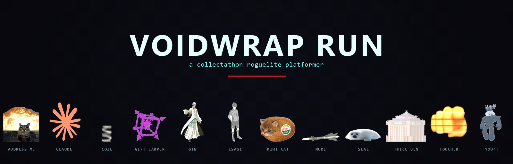

# VOIDWRAP RUN

**A collectathon roguelite platformer.** Endless seeded levels of checkered causeways strung over a
foggy void. Collect every black gift to open the beacon, then leave safe — or linger for gold while
the pressure rises. You carry two void charges: a fall spends one, the beacon gives one back, and the
third fall is the end of the run.

The world is serious. The enemies are not.

> **Status: alpha — `v0.1.1-alpha.3`.** One level, playable end to end. Not yet a 30-level run.
> See [What works today](#what-works-today) for the honest list.

**VOIDWRAP RUN is a personal, non-commercial project — no money is involved, and it is not affiliated with, endorsed by, or connected to any person, brand, character, or IP referenced or depicted in the game.**

## What changed in v0.1.1-alpha.3

One change: **the camera is locked to the character, and neither of them turns.**

Before this build the player figure rotated to face whatever direction it was moving while the
camera stayed put, so the character spun underneath a fixed view. Now the figure is locked to the
camera's forward: it always faces away from you and strafes. The camera does not turn either —
there is no mouse-look, so nothing can rotate it. Movement is still camera-relative, so "forward"
still means away from the camera.

The other reading of the request — the camera swinging around behind the character as it turns —
was built first and measured, then thrown away. It cannot work as a camera tweak: input is rotated
by the camera yaw, the character faces its velocity, and the camera chasing that facing closes a
loop. Holding a sideways direction spun the character at about **350°/s** and the camera never
caught up. The numbers are in `DECISIONS.md` (D-T082-4) so nobody re-derives them.

## What changed in alpha.3

Alpha.1 and alpha.2 shipped with the floor invisible. Six things were wrong; all six are fixed.

| what you saw | what it was | what it is now |
|---|---|---|
| Tiles had no texture at all | the level mesher emitted every tile **top** with its winding reversed, so the top face was back-facing and culled. You were looking at the slab **underside** — dark, flat, untextured | winding fixed; the tops carry the full detail stack: checker, per-texel grain, per-tile tone shift, seams, bevels, three-octave value noise, and a noise-derived normal and roughness |
| The ground you spawn on was flat colour | the hub shader was a single flat fill | the hub now runs the same detail stack as the platforms, and keeps its star sigil |
| Enemies froze on one frame | the billboard only read the legacy `animations[]` list; the sim drives the newer `anim.states` names, and 9 of 12 enemies had states with no matching art | both lists are merged, so every state the sim can ask for resolves to real art |
| First person, no body | the camera sat in the player's head | third person: a real player figure, a follow camera you can orbit, and a fill light so the figure reads against the fog |
| You fell through a platform | prop tops were not landing candidates | `move_body` takes prop tops as landings; pinned by `test_classes.gd` |
| Gifts were invisible | they were drawn, but on an untextured floor you could not see them | gifts, gold gifts, tripmines and the beacon column are all drawn in the level |

The README hero used to show the wrong image for **ADDRESS ME** — the explosion instead of the
enemy. It now shows the elephant, and all twelve cells are the real art.

## Play it

Download `voidwrap_run.exe` from the [releases page](https://github.com/heylyfe/VOIDWARP-REMAKE/releases)
and run it. Windows x86_64, single file, no installer and no runtime to install.

| input | action |
|---|---|
| `WASD` | move |
| `Space` | jump |
| `Shift` | ability — dash, per class |
| `F` | interact — gifts, mines, the beacon |
| `Tab` | toggle HUD |
| `Esc` | pause / back |

Gamepad works too. The menu's **HOW TO PLAY** panel shows the live bindings, read from
`game/data/bindings.json`.

## What works today

- **Menu** — PLAY / HOW TO PLAY / QUIT over a live 3D backdrop: the floating island, the open
  beacon's light column, and the full enemy roster standing on it as real billboards.
- **Loading screen** — 5.0 s on a first launch, 2.0 s on every restart, with a 2D gag scene and a
  30-tip pool that never repeats the previous gag.
- **Level 1** — generates from a seed, loads, plays, and completes. The beacon opens when every
  black gift is collected; the exit is a real transition, not a stub. The gifts, the gold gifts,
  the tripmines and the beacon's light column are drawn in the level itself.
- **12 enemies**, each with its own telegraph, attack, and death. They are the joke; the void is not.
- **Economy** — gifts, gold, void charges, tripmines, the beacon's charge refund.
- **After a level** — the world tears down and the app opens the Antechamber (the lobby); the next
  level is built from the lobby's ledger.

Known gaps, stated plainly:

- **The bot completes level 1 in 98 of 100 seeds** (seed base 60717, the pinned 4.7.2 engine,
  100 seeds re-measured on this tree). The acceptance bar is 95. The probe crashes with a Godot
  `Unreferenced static string` error at around 30 runs in one process, so long runs are measured
  in chunks; seeds are independent, so the splice loses nothing.
- **No 30-level run yet.** The intermission lobby is wired into the app loop: a completed level
  tears the world down and opens the Antechamber (`view/lobby/lobby_scene.gd`), and the next
  level is built from the lobby's ledger (class, votes, curses, purchases) when the player walks
  into the Descent Gate. What is still missing is a shipped, full-length run — one level at a
  time is what exists today.
- **Three of the five parked HIGH bugs are closed** ([`PARKED.md`](PARKED.md) rows 25–28): the
  Last Light body push now reaches the live enemy rows, ramp kinds 3 and 4 report the slope the
  mesh draws, and every enemy body mirror is refreshed each step so the safe-tile and SR-4 checks
  stop reading spawn points. The bot route regressions are partly closed. One exe-related row was
  closed by the v0.1.0-alpha.1 export.

## How a run works

1. **Spawn** on a causeway over the void. Two void charges in hand.
2. **Collect** every black gift on the level. The beacon stays shut until the last one.
3. **Decide** — walk into the open beacon and bank the run, or stay out for gold while the enemies
   get faster and the fog closes in.
4. **Fall** and you spend a charge. Fall with none left and the run ends.

Between levels the design calls for a lobby: class choice, enemy votes, curses, upgrades. That is
built, tested as a simulation, and wired into the app loop: completing a level opens the Antechamber,
and the next level builds from the lobby's ledger.

## Where things are

| path | what |
|---|---|
| [`DESIGN.md`](DESIGN.md) | the game: loop, economy, enemies, curses, upgrades, lobby, architecture |
| [`DECISIONS.md`](DECISIONS.md) | every significant decision with its why — read this first |
| [`ENEMIES.md`](ENEMIES.md) | the fixed enemy roster and its hard rules |
| [`TERRAIN_SPEC.md`](TERRAIN_SPEC.md) | the terrain generator spec; [`TERRAIN_REF.md`](TERRAIN_REF.md) is its reference |
| [`PARKED.md`](PARKED.md) | known bugs, each with the test that hides it and why it parked |
| [`AUDIT.md`](AUDIT.md) / [`TBD.md`](TBD.md) | the audit trail and the open questions |
| [`FLEET_PACK.md`](FLEET_PACK.md) | the ticket pack the multi-agent build ran from |
| [`terrain_ref/`](terrain_ref) | Python reference generator, validator and renderer (stdlib only) |
| [`game/`](game) | the Godot 4.7.2 project |
| [`game/app/`](game/app) | the app loop: menu → loading → world |
| [`game/sim/`](game/sim) | the simulation core — deterministic, headless, testable |
| [`game/content/enemies/`](game/content/enemies) | one folder per enemy: data, behaviour, sprites, sources |
| [`game/data/`](game/data) | tunable data — offering schedule, tips, bindings |
| `assets_src/enemies/` | the 17 source images the sprites are derived from. Not tracked — they are third-party material, not ours to redistribute, so they stay on the author's disk as the input of `game/tools/art/*.gd`. The derived sprites under `game/content` are what ships |
| [`research/`](research) | design research, the v1 retrospective, the run reports |

## Development

Engine: **Godot 4.7.2** (MIT), fetched into `tools/godot/` and never committed — see
[`tools/godot/README.md`](tools/godot/README.md). Language: GDScript. Ships as a native Windows
executable; no Electron, no browser wrapper.

```powershell
# look at a level without opening the engine
python terrain_ref\voidgen.py --seed 1 --level 1 --ascii
python terrain_ref\render.py --seed 7 --level 30 --out terrain_ref\out\l30.png

# the generator's invariants
python terrain_ref\gallery.py --check            # 16 pinned levels
python terrain_ref\validate.py --seeds 0:5000    # every invariant, 5,000 seeds
```

### Tests

```powershell
$G = "tools\godot\godot.exe"

# every discovered test (game/tests/test_*.gd; each exposes func run() -> Array[String])
& $G --headless --path game --script res://tests/run_all.gd

# terrain parity: GDScript generator against the Python goldens
& $G --headless --path game --script res://tests/test_terrain_parity.gd -- "$PWD\terrain_ref\gallery.json"

# the merge gate: every check except the 5,000-seed harness and the export
powershell -File tools\gate.ps1

# the full 5,000-seed generation harness
powershell -File tools\harness.ps1
```

The gate is the contract: 62 test files, terrain parity, sprite validation, fog readability across
five biomes, and a zero-`SCRIPT ERROR` requirement. Nothing merges red.

### Build

```powershell
& $G --headless --path game --export-release "Windows Desktop" ..\build\voidwrap_run.exe
```

The presets live in [`game/export_presets.cfg`](game/export_presets.cfg) — `Windows Desktop`, `Linux`
and `macOS` — and the output lands in `build/`, which is gitignored. `Linux` and `macOS` need the
4.7.2 export templates installed for your engine; the Windows one already ships them.

Exporting by hand needs the templates for the target platform in the engine's templates folder. CI
does not: [`.github/workflows/build.yml`](.github/workflows/build.yml) fetches the engine and its
templates for the pinned version on each runner, refuses to build if the binary does not report
`4.7.2.stable.official.ed1daf0bf`, and uploads a build per platform on every push, pull request and
tag. Tag builds are also attached to the GitHub release.

| Target | Artifact | Notes |
| --- | --- | --- |
| Linux x86_64 | `voidwrap_run.x86_64` | single binary, pck embedded |
| Windows x86_64 | `voidwrap_run.exe` | single binary, pck embedded |
| macOS universal | `voidwrap_run.zip` | `VOIDWRAP RUN.app`, x86_64 + arm64, **unsigned**, cross-built on Linux |

The macOS build is unsigned and not notarized, so Gatekeeper blocks it on a fresh machine until the
user clears it (`System Settings > Privacy & Security > Open Anyway`). Signing needs an Apple
Developer identity, which the project does not have.

macOS builds only work because [`game/project.godot`](game/project.godot) imports the ETC2/ASTC
texture variants: Godot refuses an arm64 export without them. The desktop presets do not pack those
variants, so their builds are unchanged by it.

## Credits

- **Engine** — [Godot](https://godotengine.org) 4.7.2, MIT.
- **Enemy source images** — third-party material, used without licence for a personal
  non-commercial project. Per-enemy provenance is in `game/content/enemies/*/SOURCES.md`.
- **Everything else** — generated for this project: terrain, meshes, audio cues, UI.

this is a personal, non-commercial project with no money involved. It is not affiliated with, endorsed by, or connected to any person, brand, character, or IP referenced or depicted in the game.
