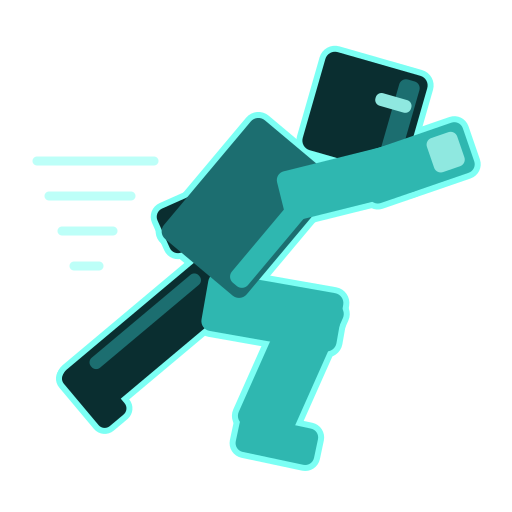
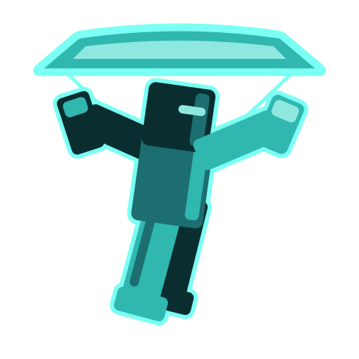
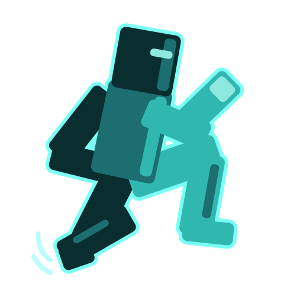

# VOIDWRAP RUN

**A collectathon roguelite platformer.** Seeded levels of checkered causeways strung over a foggy
void. Collect every black gift to open the beacon, then leave safe — or stay out for gold while the
level collapses inward behind you. You carry two void charges: a fall spends one, the beacon gives
one back, and the third fall ends the run.

The world is serious. The enemies are not.

> **Status: alpha — `v0.1.15-alpha.3`.** Playable end to end, level after level, with the lobby, the
> shop and the collapse all wired. Not yet a proven 30-level run — see
> [What works today](#what-works-today) for the honest list.

**VOIDWRAP RUN is a personal, non-commercial project — no money is involved, and it is not affiliated with, endorsed by, or connected to any person, brand, character, or IP referenced or depicted in the game.**

## Play it

Download `voidwrap_run.exe` from the [releases page](https://github.com/heylyfe/VOIDWARP-REMAKE/releases)
and run it. Windows x86_64, single file, no installer and no runtime to install. Linux and macOS
builds are on the same page.

| | |
|---|---|
| **Engine** | Godot 4.7.2, GDScript |
| **Platforms** | Windows x86_64, Linux x86_64, macOS universal |
| **Classes** | 3 — Dasher, Glider, Athletic |
| **Enemies** | 12, each with its own telegraph and its own answer |
| **Upgrades / curses** | 36 / 46 |
| **Levels** | seeded and endless; 30 to a run |

## Controls

| input | action |
|---|---|
| `WASD` | move |
| `Space` | jump |
| `Shift` | ability — dash, glide, or nothing, per class |
| `F` | interact — gifts, mines, the beacon |
| `Tab` | toggle HUD |
| `Esc` | pause / back |

Gamepad works too. The menu's **HOW TO PLAY** panel shows the live bindings, read from
`game/data/bindings.json`.

## Classes

Pick one at the class altar in the pre-run lobby. No class is ever required by the terrain — every
level is completable with any of the three.

| | class | what it does |
|:--:|---|---|
|  | **Dasher** | **Dash** 6 u in 0.20 s in the input direction, usable in the air, with vertical speed held at 0 for the duration. One charge, back in **3.0 s**. The answer to a gap that is just too wide. |
|  | **Glider** | **Hold jump while falling** to cap your fall at 2.0 u/s and hold 10 u/s horizontally. 3.0 s of glide energy per airtime, refilled on landing — 30 u of travel for 6 u of height. The answer to a drop you would rather not take. |
|  | **Athletic** | **+15% run speed** from the first step (10.35 u/s), speed upgrades **×1.5** as strong, double-jump upgrades **×1.3** height. No active ability — the answer is that you are simply faster. |

**Shared kit, all three classes:** run 9 u/s, jump apex 2.25 u, gravity 32, coyote time 0.10 s,
jump buffer 0.10 s, variable jump cut (releasing halves your vertical speed), auto step-up 0.5 u,
100% air control.

**Ability lock.** Some hazards lock your class for a moment — the toucher's glitched floor, coil's
landing shockwave. While a lock holds, the Dasher cannot dash and its cooldown does not tick, the
Glider cannot start a glide and an active glide ends, and the Athletic loses its +15% and its
upgrade multipliers drop to ×1.0. Purchased upgrades still work at normal strength.

## Enemies

Twelve, fixed. Every one is a kill or a shove — there is no damage number anywhere in this game.
Every body contact kills, and every projectile, ring, beam, blast and void zone kills on hit. The
only three non-lethal effects in the roster are thicc ben's launch, coil's shockwave and the
toucher's floor.

| enemy | what it does | how to beat it |
|---|---|---|
| **kiwi cat** | Floats at you at 1.5 u/s, straight across the void, ignoring the walkways you have to follow. Meows every 3 s within 14 u. Contact kills. | Walk away on open ground. On a thin path or a dead end, **hurdle it as it arrives** — a jump clears its 1.5 u reach for 0.43 s. |
| **coil** | Idles 3 s, then a 0.6 s "boing" and a 3 u ring mark the landing zone: **the last tile you stood on**. Lands 2.75 s later. Landing on you kills; the 6 u shockwave shoves you outward at 8 u/s and locks your class for 2 s. | Leave the ring, and be airborne or more than 6 u from that tile when it lands. An idle coil is hurdle-able. |
| **thicc ben** | Teleports to you every 13.35 s. Black smoke marks the spot for 1.25 s and the destination locks at smoke start. Touching him blurs your screen and launches you upward at 18 u/s. **He never kills by touch.** | Move 4 u from the smoke and he appears where you were. The launch is a free super-jump when you have room — and a death sentence on a spire top or under a bridge. |
| **Isagi** | Relocates to the perch nearest you with line of sight, winds up 1.2 s, then fires volleys of up to 3 balls 0.15 s apart, 0.75 s between volleys. 22 u/s, straight line, never homing. | Get a **2 HU step** (1.0 u) between you and him, or jump after the release flash. On a lane anchor he leaves within 4 s. |
| **nuke** | Locks you, tracks 2.5 s with a rising beep, then a missile descends 1.5 s and detonates a 5 u sphere. Kills. | **Leave the 5 u sphere within 1.5 s**, or put a prop, spire pad, bastion wall or tile slab between you and the sky. Either works on its own. |
| **YOU?!** | Floats at you at 3.4 u/s. Within 10 u it rumbles 1.5 s, then sends a 1.0 u tall ring outward at 9 u/s to radius 14 u. Jumpable. Touch kills. | Jump as the ring reaches you, or stand 1.5 u above or below its feet. |
| **gift Larper** | The tripmine. Stationary, sits in gift slots, and every vote adds three more. | Look before you land. The tell is visible from 12 u — 1.23 s of warning at run speed. |
| **toucher** | Floats at you at 6.75 u/s, faster than you can outrun on its own floor. Every 2 s it infects tiles within 3 u below it; glitched tiles slow you 20% and disable your class for 12 s. Touch kills. | Keep height between you and **hurdle it** — a clean jump clears its 1.4 u body with 0.85 u to spare. Its floor also invalidates your newest safe-tile respawns. |
| **seal** | Flaps at you at 4 u/s. Between 4 u and 12 u it fixes a 3D dash line through you, telegraphs 0.75 s, then barks and dashes 20 u in 1.0 s. The line never re-aims. | **Jump on the bark**, or stand a 3 HU step (1.5 u) above or below the line, or sidestep 0.7 u on a 2-wide path. |
| **address me** | Appears 6 u in front of you, trumpets, and gives you 5.0 s. It only arrives when nothing else is threatening you. | **Stop.** No input, under 0.5 u/s, for 1.5 continuous seconds. You have 3.5 s of slack. |
| **Claude** | Floats at 4 u/s within 20 u, playing at 100 BPM and attacking once per bar: **drums** (an 18 u ring on beats 1 and 3), **strings** (a 24 u beam sweeping 120°), **wind** (three homing shots at 7 u/s). Agitation rises 2/s and speeds the tempo. | Jump the drums on the beat; keep 6 u and a height step from the strings; outrun the wind shots in a straight line or drop one tread — they die on any slab. Grab the clawd Crab plushies to cut agitation by 35. |
| **gin ichimaru** | Fades in 15–25 u away, always on a platform tile so his body never blocks the route home. Marks a 5×5 patch on your tile for 2.0 s, then it becomes a void zone for 10 s. | **Walk out of the patch** — 3 cells, 0.33 s of running inside a 2.0 s mark. Change direction on a Twin Fangs double mark. |

## How a run works

1. **Spawn** on a causeway over the void with two void charges in hand.
2. **Collect** every black gift on the level. The beacon stays shut until the last one.
3. **Decide** — walk into the open beacon and bank the run, or stay out for gold. Staying out is on
   a clock that closes in like a shrinking safe zone: five seconds after the beacon opens the
   farthest ring of platforms cracks and falls into the void five seconds later; ten seconds after
   that the next ring inward cracks, and so on until only the hub is left. A countdown at the top of
   the screen says which ring is next and how long you have. Rings are 8 u thin, so each fall takes a
   slice rather than a chunk: 4 to 12 rings by level size, 55 to 175 s from the beacon opening to the
   last ring gone (median 106 s; the numbers are in `game/data/collapse.json`, rulings D-B11-1 and
   D-B12-1). Gold on a ring that falls is gone with it.
   Enemies get faster and the fog closes in while you are out there.
4. **Fall** and you spend a charge. Fall with none left and the run ends.

Between levels the Antechamber opens: class altar, enemy votes, curses, upgrades. The next level is
built from the lobby's ledger when you walk into the Descent Gate.

## What works today

The whole loop is wired and runs on the shipped code path: menu → loading → level → Antechamber →
next level.

- **Menu** — PLAY / HOW TO PLAY / QUIT over a live 3D backdrop: the floating island, the open
  beacon's light column, and the full enemy roster standing on it as real billboards.
- **Loading screen** — 5.0 s on a first launch, 2.0 s on every restart, with a 2D gag scene and a
  30-tip pool that never repeats the previous gag.
- **A level** — generates from a seed, loads, plays, completes. The beacon opens when every black
  gift is collected; the exit is a real transition, not a stub. Gifts, gold gifts, tripmines and the
  beacon's light column are all drawn in the level.
- **12 enemies**, each with its own telegraph, attack, death and view.
- **Economy** — gifts, gold, void charges, tripmines, the beacon's charge refund.
- **The Antechamber** — class altar, enemy votes, curses, the shop. The next level is built from the
  lobby's ledger when you walk into the Descent Gate.
- **The collapse** — the shrinking safe zone, with crack decals, a fall animation, and a removed-tile
  set that collision, gifts, mines and the view all read.
- **Pause, settings and records** — ESC freezes and resumes the run from the tick it stopped on;
  volume, FOV, fullscreen and mouse sensitivity all persist; best level and best purse ratchet up in
  a local JSON store.

**Upgrades: price, tier and when the shop offers them.** Generated from the data by
`game/tools/upgrade_table.gd -- --write`; `tests/test_upgrade_tiers.gd` fails if this block and the
data disagree. "pool from" is the first level whose shop pool holds the upgrade; "first shop" is the
first lobby at or after it that has a shop (shops follow levels 1, 4, 5, 7, 10, 11, ...). Levels are
the level just completed. A stacked price is `floor(price x 1.5^stacks)`.

<!-- upgrade-table:begin (generated by game/tools/upgrade_table.gd - do not edit by hand) -->

| tier | list price band | in the pool from level |
|---|---|---|
| T1 | 40-80 g | 1 |
| T2 | 120-200 g | 4 |
| T3 | 280-400 g | 10 |
| T4 | 550-800 g | 18 |
| T5 | 1100-1500 g | 26 |

| upgrade | tier | price | 2nd stack | 3rd stack | max stacks | pool from | first shop | class |
|---|---|---|---|---|---|---|---|---|
| Paycheck | T1 | 40 | 60 | 90 | 3 | 1 | 1 | all |
| Radar Module: Beacon | T1 | 40 | - | - | 1 | 2 | 4 | all |
| Field Dressing | T1 | 45 | 67 | - | 2 | 2 | 4 | all |
| Ledge Grace | T1 | 50 | 75 | - | 2 | 2 | 4 | all |
| More | T1 | 50 | 75 | 112 | 5 | 1 | 1 | all |
| Long Reach | T1 | 60 | 90 | 135 | 3 | 2 | 4 | all |
| Yearn for Speed | T1 | 60 | 90 | 135 | 4 | 1 | 1 | all |
| Radar Module: Gifts | T1 | 70 | 105 | - | 2 | 2 | 4 | all |
| Sure Foot | T1 | 70 | 105 | - | 2 | 2 | 4 | all |
| Brace | T1 | 80 | 120 | 180 | 3 | 2 | 4 | all |
| Bargain | T2 | 120 | 180 | - | 2 | 4 | 4 | all |
| Bounty Hunter | T2 | 130 | - | - | 1 | 4 | 4 | all |
| Hot Streak | T2 | 140 | 210 | - | 2 | 4 | 4 | all |
| Straggler Scope | T2 | 140 | - | - | 1 | 4 | 4 | all |
| Featherfall | T2 | 150 | - | - | 1 | 4 | 4 | all |
| Gilded Touch | T2 | 150 | 225 | 337 | 3 | 4 | 4 | all |
| Insulation | T2 | 150 | - | - | 1 | 4 | 4 | all |
| Nest Egg | T2 | 160 | 240 | - | 2 | 4 | 4 | all |
| Quick Recovery | T2 | 160 | 240 | - | 2 | 4 | 4 | all |
| Radar Module: Threats | T2 | 160 | - | - | 1 | 4 | 4 | all |
| Stand Fast | T2 | 170 | - | - | 1 | 4 | 4 | all |
| Early Warning | T2 | 180 | 270 | - | 2 | 4 | 4 | all |
| Spring Heels | T2 | 180 | 270 | - | 2 | 4 | 4 | all |
| Defuse Kit | T2 | 200 | 300 | 450 | 3 | 4 | 4 | all |
| Cold Blood | T3 | 280 | - | - | 1 | 10 | 10 | all |
| Last Call | T3 | 300 | - | - | 1 | 10 | 10 | all |
| Radar Module: Mines | T3 | 300 | - | - | 1 | 10 | 10 | all |
| Slipstream | T3 | 300 | - | - | 1 | 10 | 10 | all |
| High Ceiling | T3 | 320 | - | - | 1 | 10 | 10 | all |
| Marathon | T3 | 340 | - | - | 1 | 10 | 10 | athletic only |
| Twin Dash | T3 | 340 | - | - | 1 | 10 | 10 | dasher only |
| Updraft | T3 | 340 | - | - | 1 | 10 | 10 | glider only |
| Subspacial Barrier | T3 | 350 | - | - | 1 | 10 | 10 | all |
| Cartographer | T4 | 600 | - | - | 1 | 18 | 19 | all |
| Skeleton Key | T4 | 750 | - | - | 1 | 18 | 19 | all |
| Pocket Beacon | T5 | 1200 | - | - | 1 | 26 | 28 | all |

<!-- upgrade-table:end -->


Known gaps, stated plainly.

1. **The bot completes level 1 in 97 of 100 seeds** (seed base 60717, the pinned 4.7.2 engine,
   re-measured on this tree after the collapse landed). The acceptance bar is 95. The probe crashes
   with a Godot `Unreferenced static string` error at around 30 runs in one process, so long runs
   are measured in chunks; seeds are independent, so the splice loses nothing.
2. **The difficulty bands are NOT met, and the probe that measures them cannot reach them.**
   Measured on this tree (seed base 60717, 20 runs, full depth): level 6 = 20% against a bar of
   ≥80%; level 12 = 0% against 40–60%; level 18 = 0% against 15–30%; median level reached 4, max 8.
   Two probe defects were found and both are fixed, which is why those numbers are the honest ones.
   The bot had no mine model at all — it advanced the sim through `MinesScript.tick()` and never
   read a mine position, so 37 of 99 deaths were tripmines it could not see. It also routed over
   unsupported tiles and fell into the void in 5 of 20 runs. With both fixed, D-VOID went to ZERO
   and every remaining death was a genuine enemy kill.
   A later bot fix (D-B9-1) took level 6 from 15% to 20% and coil deaths from 8 to 5 — the bot had
   been standing in coil rings it had decided were out of reach — and cost 2 mine deaths. Both were
   traced: in each the bot was inside a coil's 6 u shockwave when the mine killed it, at a mine
   distance of 0.90 and 0.89 against a 0.97 guard, so the guard held. One was **standing** when the
   shockwave shoved it in; the other was **rising** when the jump it chose to leave the ring carried
   it in, and mine contact is height-blind by design. The coil's forced movement is what puts it in
   the cylinder, not a dodge that leaves the platform (PARKED row 33). A follow-up (D-B9-2) made the
   mine guard look 3 u ahead while airborne instead of 1.2 u, since an arc covers more ground than a
   step: on 60 seeds with the same seeds both sides that is level 6 18.3% → 20.0% and mine deaths
   3 → 2, both one run, so it is a correctness fix and not a cure. The current table is Coil 5,
   Kiwi 6, YOU?! 5, Toucher 1, Mine 2.
   The bands still fail because survival collapses in the middle of the run, not because of a bug:
   per-level survival — the share of runs that survive level N — is 95 / 80 / 65 / **35** / **15**
   percent for levels 1–5, measured in the same 20-run sweep as the band numbers above. Levels 3 and
   4 differ only by one extra enemy body, and survival drops 30 points; levels 4 and 5 drop 20 more.
   No enemy-data change closes that. These are not independent trials — the ledger accumulates
   purchases and stacks as the run goes deeper, so multiplying them understates the real depth (the
   product is 2.6%, while the measured level-6 rate is 15%). The one band-safe change identified —
   moving the third enemy vote from lobby 3 to lobby 5, which preserves every DESIGN §9 row and
   would take level 6 to roughly 48% — is recorded in `PARKED.md` row 31 and NOT applied, because
   tuning the game to satisfy an instrument that cannot play it is the mistake the mine model
   already exposed. The bands are a target for a competent human and this probe cannot validate
   them.
3. **Seven levels are proven end to end; thirty are not, and the blocker is the bot.** The
   intermission lobby is wired into the app loop: a completed level tears the world down and opens
   the Antechamber (`view/lobby/lobby_scene.gd`), and the next level is built from the lobby's
   ledger (class, votes, curses, purchases) when the player walks into the Descent Gate.
   The app cannot be driven headless at all (it reads devices only through the `Input` singleton,
   which delivers no key state without a window), so a proof has to drive the level loop directly.
   That loop is proven: a driver that builds the real world and the real lobby, buys from the shop
   and carries the ledger forward completes **7 consecutive levels** and dies on the 8th —
   `deepest=8 completed=7 lobbies=7 purchases=1 stack_types_carried=1 purse=97 class=glider`.
   Before the collapse landed the same driver reached level 10. That is not a regression in the
   loop but in the bot's route: under the old global fall it was caught 50 u out, fell, spent a
   charge and respawned on the dais, which teleported it past a kiwi cat. Now it has to walk in, and
   the cat kills it 21 u from the dais with both charges still in hand. Through the 7 levels both
   runs complete, the purse is 246.28 → 256.28 (+10.00): each level pays more and the run is
   shorter. So the intermission handoff, the purchase path and the carried stacks all work at depth.
   What is not proven is 30 levels, and the reason is the bot rather than the harness. A second,
   simpler harness (`BotRun.play_run`, which does not shop between levels) does worse — across 24
   seeds it enters a median of 4 levels, best 8, worst 2 — which is itself the useful signal:
   shopping between levels roughly doubles the depth the same bot reaches. Proving a 30-level run
   now needs a better bot or a human playthrough, not more driver work. What IS proven at depth is
   that the sim survives it: `test_depth_smoke.gd` builds a real world at levels 1, 12, 18, 24 and
   30 and steps each for 600 ticks, so the content above level 11 is exercised even though no run
   reaches it.
4. **Every enemy has its own view, but the art is procedural.** Nine per-enemy view files (2,219
   lines) had existed with nothing instantiating them, so every enemy rendered as a generic
   billboard; `view/enemies/enemy_view_host.gd` now routes a live enemy row to its own view and
   feeds it spawn, telegraphs and per-tick state, and coil got the one body it was missing
   (`view/coil_view.gd`). The three screen effects that only tests ever called — the void-edge
   flash, the Last Light bloom and the pip shatter — are wired to their real sim events.
   `test_app_enemy_views.gd` proves all nine through `world.build()`/`world.step()` and drives its
   own negative control, which reports 40 failures across 10 legs. What remains is art quality, not
   wiring: the views are procedural placeholders, not the bespoke sprite work the art brief
   describes.
5. **The tripmine needs no tuning, and the numbers say so.** The tell is visible from 12.0 u, the
   contact cylinder is 0.9 u and the player runs 9.0 u/s, so the warning is 1.23 s against a human
   reaction-plus-decision budget of 0.75 s. The tell ramps in rather than popping, fog leaves 87% of
   it at 12 u, and the minimum mine-to-mine distance across 200 levels is 2.000 u, so no wall can
   form. Mines are absent for levels 1–4 and appear at level 5 (`gift_larper` carries
   `min_level: 5`), which is a deliberate staircase: the counter-play (Defuse Kit) is first buyable
   at the post-L4 shop, exactly before the hazard appears.
6. **PARKED rows 25–28 are closed.** Row 25 (the Last Light body push now reaches the live enemy
   rows), row 26 (ramp kinds 3 and 4 report the slope the mesh draws, with `test_classes.gd`
   covering all four kinds), row 27 (every enemy body mirror is refreshed each step so the safe-tile
   and SR-4 checks stop reading spawn points) and row 28 (the dead `rt_set`, the per-spawn
   `round_trip_set` rebuild, the dead `_killer_on_screen` branch and the write-only
   `spawn_deferred` field — all removed in `b2c5fa9`). Row 28's unproducible empty-C-bay stall
   outcome is a deliberate forced-gate behaviour in the bot, not a defect.

## Where things are

| path | what |
|---|---|
| [`DESIGN.md`](DESIGN.md) | the game: loop, economy, enemies, curses, upgrades, lobby, architecture |
| [`DECISIONS.md`](DECISIONS.md) | every significant decision with its why — read this first |
| [`ENEMIES.md`](ENEMIES.md) | the fixed enemy roster and its hard rules |
| [`TERRAIN_SPEC.md`](TERRAIN_SPEC.md) | the terrain generator spec; [`TERRAIN_REF.md`](TERRAIN_REF.md) is its reference |
| [`PARKED.md`](PARKED.md) | known bugs, each with the test that hides it and why it parked |
| [`AUDIT.md`](AUDIT.md) / [`TBD.md`](TBD.md) | the audit trail and the open questions |
| [`FLEET_PACK.md`](FLEET_PACK.md) | the ticket pack the multi-agent build ran from |
| [`terrain_ref/`](terrain_ref) | Python reference generator, validator and renderer (stdlib only) |
| [`game/`](game) | the Godot 4.7.2 project |
| [`game/app/`](game/app) | the app loop: menu → loading → world |
| [`game/sim/`](game/sim) | the simulation core — deterministic, headless, testable |
| [`game/content/enemies/`](game/content/enemies) | one folder per enemy: data, behaviour, sprites, sources |
| [`game/data/`](game/data) | tunable data — offering schedule, tips, bindings, collapse |
| `assets_src/enemies/` | the 17 source images the sprites are derived from. Not tracked — they are third-party material, not ours to redistribute, so they stay on the author's disk as the input of `game/tools/art/*.gd`. The derived sprites under `game/content` are what ships |
| [`research/`](research) | design research, the v1 retrospective, the run reports |

## Development

Engine: **Godot 4.7.2** (MIT), fetched into `tools/godot/` and never committed — see
[`tools/godot/README.md`](tools/godot/README.md). Language: GDScript. Ships as a native Windows
executable; no Electron, no browser wrapper.

```powershell
# look at a level without opening the engine
python terrain_ref\voidgen.py --seed 1 --level 1 --ascii
python terrain_ref\render.py --seed 7 --level 30 --out terrain_ref\out\l30.png

# the generator's invariants
python terrain_ref\gallery.py --check            # 16 pinned levels
python terrain_ref\validate.py --seeds 0:5000    # every invariant, 5,000 seeds
```

### Tests

```powershell
$G = "tools\godot\godot.exe"

# every discovered test (game/tests/test_*.gd; each exposes func run() -> Array[String])
& $G --headless --path game --script res://tests/run_all.gd

# terrain parity: GDScript generator against the Python goldens
& $G --headless --path game --script res://tests/test_terrain_parity.gd -- "$PWD\terrain_ref\gallery.json"

# the merge gate: every check except the 5,000-seed harness and the export
powershell -File tools\gate.ps1

# the full 5,000-seed generation harness
powershell -File tools\harness.ps1
```

The gate is the contract: 124 tests, terrain parity, sprite validation, fog readability across five
biomes, and a zero-`SCRIPT ERROR` requirement. Nothing merges red.

### Build

```powershell
& $G --headless --path game --export-release "Windows Desktop" ..\build\voidwrap_run.exe
```

The presets live in [`game/export_presets.cfg`](game/export_presets.cfg) — `Windows Desktop`, `Linux`
and `macOS` — and the output lands in `build/`, which is gitignored. `Linux` and `macOS` need the
4.7.2 export templates installed for your engine; the Windows one already ships them.

Exporting by hand needs the templates for the target platform in the engine's templates folder. CI
does not: [`.github/workflows/build.yml`](.github/workflows/build.yml) fetches the engine and its
templates for the pinned version on each runner, refuses to build if the binary does not report
`4.7.2.stable.official.ed1daf0bf`, and uploads a build per platform on every push, pull request and
tag. Tag builds are also attached to the GitHub release.

| Target | Artifact | Notes |
| --- | --- | --- |
| Linux x86_64 | `voidwrap_run.x86_64` | single binary, pck embedded |
| Windows x86_64 | `voidwrap_run.exe` | single binary, pck embedded |
| macOS universal | `voidwrap_run.zip` | `VOIDWRAP RUN.app`, x86_64 + arm64, **unsigned**, cross-built on Linux |

The macOS build is unsigned and not notarized, so Gatekeeper blocks it on a fresh machine until the
user clears it (`System Settings > Privacy & Security > Open Anyway`). Signing needs an Apple
Developer identity, which the project does not have.

macOS builds only work because [`game/project.godot`](game/project.godot) imports the ETC2/ASTC
texture variants: Godot refuses an arm64 export without them. The desktop presets do not pack those
variants, so their builds are unchanged by it.

### Tester build (owner only, never released)

The owner's debug build: an exe with an F10 debug panel — spawn any enemy at the cursor or in front
of the player, give any upgrade (its event hooks live from the next tick), give gold, collect the
nearest gifts (queued into the tick, so payouts and hooks land normally), skip to level N or skip the
current level, set charges, toggle god mode (levels, arena and a new world's first tick), force the
platform collapse, force the Peter boss fight (the real arena entry: teleport, first-person mode,
HUD) and the Bankai cinematic (driven through its signals, insta-killing Peter on `target_hit`), and
read the live state hash. Debug actions go through the game's own paths (the enemy runtime's
`spawn_at`, `sim/gifts.gd`'s `collect`, queued tick jobs, the app's level-transition calls), and no
`sim/` file is touched: the 60 Hz determinism, the state-hash dump and the replay suite are exactly
the public build's. A run played in the tester build is flagged `"tester": true` in its `user://runs`
log header.

```powershell
powershell -File tools\build_tester.ps1   # -> game\out\tester\voidwrap_tester.exe
```

The panel ([`game/view/tester/debug_panel.gd`](game/view/tester/debug_panel.gd)) exists **only** in
this exe, and this exe is **never** uploaded, attached to a release or shipped: the `Tester` preset
in [`game/export_presets.cfg`](game/export_presets.cfg) is the only one with
`custom_features="tester"`, the three public presets exclude `view/tester/*` from their pack, the
CI workflow's matrix names the three public presets by hand (it cannot pick this one up), and
`game/app/app.gd` holds one guarded reference to the panel — a `load()` (never `preload()`) behind
`OS.has_feature("tester")` — so a public build never resolves it. An editor run can get the panel
the same way: `godot --path game --features tester`. Everything a debug action does is live
in-memory state on top of the seed's own run — the seed replay itself stays byte-identical.

## Changelog

<details open>
<summary><b>What changed in v0.1.15-alpha.3</b> — the Peter Griffin boss fight, and four enemies rebuilt</summary>

**Peter Griffin at level 10.** Collect the last gift on level 10 and the level does not end: you are
teleported to a flat arena where Peter Griffin is waiting, and the camera goes first person with
mouselook. You throw gifts — 1 damage each, 5% chance to crit for 5, up to six a second — at a boss with
250 HP and a health bar. He throws a bowling ball along the floor (jump it or step aside) and, in his
green basketball pose, shoots a three-pointer aimed at where you were when he released it (move sideways
in time; the wind-up is at least 400 ms and the marker is drawn on the floor). Any hit kills you and he
laughs. Kill him and a beacon opens with 300 gold gifts, and level 11 carries on as usual. Once per
fight, with a 1-in-1000 seeded roll made at fight start so replays match, the dormant Bankai cinematic
plays instead: the gifts target Peter and he dies instantly. Rulings D-T8A-1..3, D-T8B-1..8.

**Claude.** He does nothing by himself now — no attack, no movement, no contact kill. He scatters 5 to
15 mini clawds across the map at level start, more on bigger maps, on walkable tiles and never on a
mine, the beacon, the hub or a pad. Collecting one calms him and resets his anger timer. Leave him alone
for 60 seconds and he makes a warning sound, 120 seconds and a worse one, 180 seconds and he kills you
outright. The timer runs in sim ticks, is in the state hash, and pauses once the gold phase opens.
Rulings D-T4-1..10.

**Gin.** He appears on your screen as a smiling portrait, says "bye bye" in the owner's own cleaned-up
voice line, and throws his sword along the ground at your feet. You have 650 ms from the throw to jump
it — inside the 500-750 ms window the owner asked for — and the sword is a real projectile that hits
whatever it crosses, not a homing snap. Rulings D-T5-1..5.

**"YOU?!"** Strikes smaller and slower: the shockwave ring is 8 units instead of 14, and the rumble that
tells you it is coming lasts 3 seconds instead of 1.5. He also holds position during the tell now, so
the warning is honest. Rulings D-YOU-C7-1..4.

**Jump pads** are 3x3 blocks of floor tiles, outside the paths and never on one, two to six per level
scaling with size. **The player model** picked up the refined look — wraparound shades, fuller silver
hair, a squared cone brim — on the locomotion solver that shipped in v0.1.14, because the proposal's
animator would have brought the twisted legs back. Rulings D-JUMPPAD-6..9, D-T7-1..2.

**The tester build.** A separate, owner-only export with an F10 debug panel: spawn any enemy, grant any
upgrade, give gold or gifts, skip levels, set charges, god mode, force a collapse, force Peter, force
the Bankai, read the state hash. It is compiled out of every public build — the folder is excluded from
all three public presets, the only load is behind a `tester` feature tag, and CI builds only the public
presets. `tools/build_tester.ps1` builds it to `game/out/tester/`. It is never released. Rulings
D-T2-1..9.

**Proof.** The gate is green: 142 tests, terrain parity 56/56, the 18 oracle self-tests and the 16
pinned gallery records.

</details>

<details>
<summary><b>What changed in v0.1.14-alpha.3</b> — jump pads, and legs you can actually read</summary>

**Jump pads.** A blue translucent slab sits beside a walkway — never on it — and flings the player
straight up at 20 u/s, about two stair runs of height, keeping the horizontal momentum. It refills the
movement kit: air jumps, dash, bonus dashes, glide energy and the updraft. It deliberately does *not*
refill void charges, gold, the beacon shield, Last Light or Field Dressing. Placement is deterministic
and data-driven (`terrain/jump_pads.gd`, `data/jump_pads.json`): one pad on levels 1-2, two from level
3, three from 6, four from 10, at most one per walkway and at least 12 tiles apart, never on stairs or
ramps, never on the hub, a beacon, a gift, a tripmine or a launch pad. A pad re-arms after 0.5 s and
falls with its tile when the collapse takes it. Rulings D-JUMPPAD-1..5.

**The legs read in game.** The whole leg was authored as one block in the boot colour (#0C0D10,
near-black), so thigh, shin and boot were a single black column under the dark-grey robe with no ankle
and no sole edge — which is why the legs looked like a mess in motion. The boot segment's vertex
colours are now scaled so its main face renders #3A3F4C, a cool slate a little lighter than the robe,
with the other faces keeping their authored shading ratios. View-side tone only: no geometry,
silhouette, base material, pose, controller, collision, hitbox or state-hash change. Verified on
before/after in-game captures from the real world camera, lighting and fog, walking a real stair run
and a real downhill run.

**The jump tuck and the descent camera.** The jump holds a knee tuck at thighs 1.90 rad with the knees
at the rig's 2.35 fold limit; the binding constraint is the folded boot against the torso block, not
the thigh. The descent rear view sits about 37 degrees off straight behind, chosen from an 11-offset
sweep. Two reviewer notes are recorded rather than fixed: the tuck still reads compact, and no rear
camera separates the legs in every frame — a rear view cannot show depth when the legs stack behind
the robe. The owner judges the real in-game motion.

**Proof.** The contact-sheet tool renders all 16 poses from three fixed cameras with a proof-only leg
tint (left orange, right cyan, thigh lightest to boot darkest), because the body material is unshaded
vertex colour and a light could not separate the segments. The gate is green: 138 tests, terrain
parity 56/56, the 18 oracle self-tests and the 16 pinned gallery records.
</details>

<details>
<summary><b>What changed in v0.1.13-alpha.3</b> — the run cycle, rebuilt so the legs cannot stretch</summary>

**"What the absolute fuck is this... the legs are so messed up when going side to side or up and down
stairs."** The legs were not badly animated. They were being *scaled*. `pose_leg()` in
`view/player_locomotion.gd` measured the hip-to-ankle distance, and whenever a foot target sat further
away than the leg could reach — which is exactly what a sideways step or a stair riser does — it grew
the shin past its own length and then stretched the shin mesh along its axis to match. Measured on the
old rig: the shin scaled by up to **3.65x**, a leg bone changed length by up to **1.13 u** on 1 HU
stairs, and the legs crossed the body midline by up to **0.30 u** when strafing. That is the long
diagonal black wedge in the screenshot.

**The rule now: a bone never changes length.** Every thigh, shin, boot and forearm is placed by a pure
rotation, and no basis carries scale. The two-bone solve clamps its reach — past 0.56 u it eases toward
full extension instead of snapping the knee straight — and a foot target that cannot be reached is
*missed* along the hip-to-target line rather than dragged there. A planted foot that falls out of reach
lifts off early instead of pulling the leg longer. Ruling D-ANIM-1.

**A real run cycle.** Alternating legs with a clear stride, knees that bend, arms counter-swinging, a
torso lean into forward running and a bob that peaks at mid-stance. Cadence and stride scale with
speed, with a walk-to-run blend between them. The hips sit 0.05 u lower at a full run than at a walk,
and the swing foot kicks up to 0.15 u behind the body early in the swing instead of trailing straight
back along the ground. Ruling D-ANIM-3.

**Direction-correct.** The figure keeps its facing and the feet step along the actual velocity, so
backpedalling steps backward, strafing steps sideways, and a diagonal steps diagonally. A foot never
comes nearer the body midline than 0.035 u, only the leading knee turns outward toward a sideways step,
and the torso twist fades by 70% sideways. Turning in place holds a planted foot for 0.55 rad and then
pivots it. Ruling D-ANIM-2.

**Stairs and ramps move the body, not the leg.** The hips ease to the sim's feet over 0.085 s instead
of 0.038 s, so a 0.5 u riser no longer yanks them a third of the way in one 120 Hz frame. The climb
rate is read from the ground across one unit of course and fed forward, so the hips climb a ramp or a
flight *with* the feet instead of lagging up to 0.38 u below them at 9 u/s. A swinging sole is held
above a clearance envelope sampled along its path, so it never passes down through a surface it was
over last frame. Ruling D-ANIM-4.

**Proof, not claims.** `test_player_anim.gd` drives all 16 poses through the real controller on a
staged course — flat, a 1:2 ramp, 1 HU stairs — and checks **every 120 Hz render frame**: each leg bone
within 0.002 u of 0.31 u, every leg segment and forearm at unit scale within 0.001, knees never
hyperextending and folding at most 2.75 rad, elbows never inverting, no sole corner more than 0.005 u
under the tile beneath it, knee and ankle never inside the torso block, the left leg always on the
body's −x side and the right on +x, and the controller trace bit-identical with the animation pass on
and off. **Negative control: 40 failures** against the previous animation — stretched and scaled legs
on all 16 poses, midline crossing on both strafes and the diagonal, soles in the floor on ramps,
stairs, landing and dash. Ruling D-ANIM-5.

**And you can look at it.** `tools/shot_player_anim.gd` renders the 16 poses from two fixed cameras —
side-on for the gait, rear three-quarter for the owner's angle — with the pose name and frame burned
into every PNG and one labelled sheet per pose. Ruling D-ANIM-6.

</details>

<details open>
<summary><b>What changed in v0.1.12-alpha.3</b> — the sky, the HUD, the front-end and the walk cycle</summary>

A look-and-feel release. The owner played `v0.1.11-alpha.3` and asked for four things: the storm sky
and the little contour-outlined rocks floating in it, a gold gift counter and a CTRL hint on the HUD,
a GUI that does not look like six different games, and a walk cycle that is not choppy. All four are
in, plus three fixes that landed after the last tag.

**The sky is a storm, and the rocks float in it.** A 450 u cloud dome replaces the flat void colour
behind the level: hard-edged billows, a dark mass in the lower sky and a horizontal streak band, all
drifting slowly, drawn behind everything and following the camera. 110 low-poly rocks hang in a ring
170 to 300 u out, each with a thin pale outline grown to a fixed 1.6 screen pixels so it stays a line
at any distance. Their placement and shape come from the level seed, so a level always looks the same.
Rulings D-ATMO-1..3.

**The lighting bug behind it.** `fog_env.resolve_palette` was dropping the `energy` key, so the
palette's ambient value of 2.6 had never reached the game — every level has always rendered at 1.0.
Ambient is now pinned at 1.0, which is what you were actually seeing, and the overhead glow drops
from 0.55 to 0.3 so the glowing tiles, gifts and beacon stand out against the new sky.

**The HUD is rebuilt.** One panel language in `view/hud/hud_style.gd`: dark translucent pills, 10 px
corners, three type sizes and no others, monospace for numbers. A gold gift counter takes the gift
counter's place at bottom-centre the moment the phase turns gold, and a CTRL hint reads
`CTRL TO UNLOCK MOUSE` / `CTRL TO LOCK MOUSE` off the world's own flag. Icon rows cap at 12 cells and
show `+N` past that, because the curse catalogue has more than 100 entries. Ruling D-GUI-1.

**The front-end is one game.** `view/ui_style.gd` and `view/ui_focus.gd` replace the six screens that
each invented their own palette, font sizes and button shapes. The main menu, the class altar, the
pause overlay, the settings screen, the intermission lobby and the loading chrome now share one type
scale, one spacing scale and one keyboard focus ring, and every screen is usable with mouse or
keyboard. Rulings D-FRONT-1..5.

**The walk cycle is smooth.** The choppiness had a real cause: the animation was driven from the
fixed 60 Hz sim tick, so above 60 Hz render some frames got no tick at all and the pose only moved on
tick boundaries. It now runs on the render clock with interpolation, while the sim stays on its fixed
tick and the animation never feeds back into the state hash. The gait has articulated knees and
elbows, counter-swinging arms, a foot plant that does not slide or sink, and a shorter, higher-knee,
lower-bob stride uphill. Measured: 0 of 50 frames frozen at 120 Hz against 50 of 50 before. Rulings
D-PLAYER-ANIM-1..3.

**Also in this release, from after the last tag:** the ambience bed is no longer stopped through a
freed node on teardown, and the state hash now pins lost gifts, the black quota and the straggler
band, so a run that lost a gift to the collapse no longer hashes the same as one that did not.

**"The platforms don't collapse."** They did — the schedule was right — but the first crack came
twenty seconds after the beacon opened, and the walk from the last black gift to the dais is 3 to 15
seconds (mean 6.8 s across 90 measured levels). A player heading for the beacon always finished the
level before anything fell. The grace is now five seconds, so the first ring cracks while you are
still out there and falls at ten. A countdown at the top of the screen names the next ring and its
timer. The rest of the schedule is unchanged: 8 u rings, 5 s crack, 10 s gap, 55 to 175 s to reach
the hub. Ruling D-B12-1.

**And the version badge on the main menu** no longer says `v0.1.6-alpha.3`.

</details>

<details>
<summary><b>What changed in v0.1.11-alpha.3</b> — the owner's fourteen, and the collapse becomes a shrinking safe zone</summary>

The first release built from a play-test rather than a spec. Fourteen defects the owner filed after
playing `v0.1.10-alpha.3`, plus the review and screenshot passes that followed.

**The collapse is now a shrinking safe zone.** It used to drop every non-hub platform at once, five
seconds after the beacon opened. Now the level is cut into rings by distance from the hub: the
farthest ring cracks, falls five seconds later, the next ring inward cracks ten seconds after that,
and so on until only the hub is left. Nothing cracks for the first twenty seconds. Rings are 8 u
wide, at most twelve of them, so a small level gets few and a big one gets many — 4 to 12 across the
90 measured levels, and the whole collapse runs 70 to 190 seconds instead of 20 to 80. Every number
lives in `game/data/collapse.json`. `game/tools/collapse_reach.gd` re-runs the winnability check
from the repo: 0 of 90 levels unwinnable, worst slack 99 s.

**Sound.** The game was nearly silent. Eighteen synthesized cues — footsteps, landing, dash, glide,
three gift-pickup variants, level complete, death, menu hover and click, collapse crack and fall,
the missing enemy telegraphs, lobby ambience — plus a looping ambience bed, all generated from code
by `game/tools/audio/synth_cues.gd`, with a volume control in settings. The beacon cue that was
silent in the exported build was a `FileAccess.file_exists` check against a raw `.mp3` that an
export never packs; every cue now loads through `ResourceLoader.exists`.

**The class menu works.** It used to pick for you about half the time: the altar opened during
loading, and if the loading clock finished before you clicked, the seeded replay silently chose.
The run now waits for your pick. Cards carry the class icon, the name, a plain sentence and the real
numbers, the cursor is released, and the menu is centred. A test drives the real path 100 times and
the clicked card is the chosen class 100 times.

**Enemies stack.** A voted-in enemy used to vanish after one level. `DESIGN.md` section 6 settles it
— the in-play column rises monotonically and the offer draw has a REPEAT altar — so the carried vote
set now accumulates for the rest of the run, and the HUD shows one row per active type with its
sprite and count.

**Art.** Every upgrade (36) and every curse (46) now has an icon, drawn from code by
`game/tools/art/icons.gd` in the class-icon house style. The Nullscape curse icons were used only as
inspiration for what each depicts; every one is redrawn, and `SOURCES.md` records it.

**The rest of the list.** The lobby shows your purse. Upgrade altars show their price and spell out
`CANNOT AFFORD`. Platform sides and undersides are solid instead of see-through. The About plaque is
centred. The gift pickup ring is 0.7 u instead of 0.4, data-driven, and gifts only. Walking up a ramp
no longer bobs the pickup point — the cause was a snap-down that only ran when `dy == 0`, which a
standing body never has. The run ends on a death screen with The Master, who names what killed you,
with RESTART and BACK TO LOBBY.

**Review fixes.** The gift pickup ring is now in the state hash, so two runs whose economy data
differ no longer hash the same. The schedule walk's event sink was typed `Array[String]` and silently
dropped every dictionary pushed into it. The run-over screen is pinned above the dead world's
black-out, which had been drawing it in pure black.

</details>

<details>
<summary><b>What changed in v0.1.10-alpha.3</b> — the README rebuild and the class icons</summary>

A documentation release. The binaries are functionally identical to `v0.1.9-alpha.3` — nothing under
`game/` changed. What changed is how the project presents itself.

- **The README leads with the game instead of its changelog.** Four release-note sections — about
  130 lines — used to sit between the pitch and "Play it", so a reader met a wall of history before
  learning what the game is. They are now collapsed under a Changelog heading at the bottom, with
  every word kept.
- **Two new tables.** A **Classes** table with the real numbers from `game/data/player.json` and an
  icon per class, and an **Enemies** table giving all twelve what each one does and how to beat it,
  taken from `DESIGN.md` section 5 rather than invented.
- **Three class icons** — `docs/classes/{dasher,glider,athletic}.svg`: blocky rounded prisms with a
  single bright cyan outline, in the game's own palette. The outline is `#7CFFF4`, the black-gift
  rim, and the fills are the four teal roles.
- **Two stale claims corrected against measurement.** The driver completes 7 levels and dies on the
  8th (`deepest=8 completed=7 purse=97`), not 10; and the bot completes level 1 in 97 of 100 seeds,
  not 98.

</details>

<details>
<summary><b>What changed in v0.1.9-alpha.3</b> — the collapse state hash</summary>

A fix release. The `v0.1.8-alpha.3` binaries do not carry the state-hash fix below; this tag does.
`v0.1.8-alpha.3` is left in place, unchanged.

- **The state hash pins the collapse config, not just the live schedule.** An adversarial review of
  the sequential collapse found a real collision: the `COLLAPSE` line carried only
  `phase / start / cur / fallen_n / removed_n`, so a world with the collapse enabled and one with it
  disabled hashed identically before the beacon opened, and two runs whose `game/data/collapse.json`
  differed hashed identically as well. The line now also carries `enabled`, `crack_ticks`,
  `gap_ticks` and a `partition` digest computed once at `create()`. A new test leg asserts each of
  the five collisions; reverting the line produces exactly five failures.
- **The review's honesty findings are recorded, not papered over.** "No level becomes unwinnable" is
  a straight-line bound — XZ distance at 9 u/s, ignoring jumps, height, routes, enemies and airborne
  state — not a proof. And the bot percentages are not evidence about the collapse, because
  `bot_run.gd` never runs it. Both are a dated correction on `D-B10-1` in `DECISIONS.md`, and the
  review itself is in `tickets/B10.review.md`.

</details>

<details>
<summary><b>What changed in v0.1.2-alpha.3</b> — waves 1–4, the wiring cycle</summary>

Waves 1–4 land together: the systems the earlier alphas built but never wired are wired now.

- **Every upgrade now has a shipped call site.** All 36 upgrades and
  all 46 curses were inert at the start of this work — the shop took gold and changed nothing.
  `world.gd` runs the modifier pass into the black-phase and gold-phase stat blocks and swaps them
  on the phase edges, and the controller consumes them. Field Dressing gives the free fall DESIGN
  section 8 promises, and the Last Light 8 u body push moves the live enemy rows instead of a
  spawn-time copy. The wiring was mutation-tested five ways; the follow-up found a real hole (stack
  repetition was unproven) and closed it.
  A final fresh-eyes review of this cycle's diff found the same defect still true for nine more:
  every sim-side consumer existed and was tested, and the call site in the shipped path did not,
  so the tests proved the sim and not the game. `pocket_beacon` — the most expensive upgrade in the
  game at 1200 g — could never teleport, because its channel was only ever advanced by the bot
  engine. `bounty_hunter`'s +50% bounty was never shown or paid, because the real Antechamber never
  ran the draw pass. Both are wired now, along with `more`, `last_call`, `straggler_scope`,
  `spring_heels`, `twin_dash`, `updraft` and `marathon`. The last gap, `quick_recovery`'s Athletic
  branch, is closed: the Athletic has no class cooldown, so the rule sentence gives it +5% run
  speed per stack instead, and the stat pipeline now takes a per-upgrade contribution for exactly
  that (DECISIONS D-B5A-1). The 46th curse, `zoomies`, is retired by design — the kiwi cat never
  dashes or lunges (DESIGN section 5, decision J6, SR-5) — and `test_curse_retired.gd` proves it
  can never be offered or dispatched, so it cannot cost a player a curse slot.
- **The curses are dispatched now.** 11 curses are pure stat modifiers and always applied through
  the modifier pass. The other 35 declare a script, and each had a module with its own unit test
  while nothing in the shipped game called any of them — the run tracked `curses_held` and handed
  it to the world, and no code walked that dict. `sim/curse_runtime.gd` is that walk: it reads the
  held ids generically, loads each module through a loader the world hands it, and runs the four
  hooks (`on_level_start`, `on_tick`, `on_beacon_open`, `on_void_fall`) in sorted id order. The
  pure queries — a blast radius, a tell distance, a rim glow, a reroll plinth, a straggler beam —
  now have their real consumers in the mines, the views and the lobby.
  34 of the 35 script curses are proven to change the game through `world.build()` and
  `world.step()`, each against a control world with the curse absent. The 35th is `zoomies`, which
  is retired from the offer pool and has no module. Two curses needed a design ruling to become
  live at all: `crumbling` reads "1-wide walkway tiles" as the outer lane of a walkway, because
  GEN_VERSION 4 makes every walkway three cells wide and the literal reading could never fire; and
  the glitched floor is no longer slippery by itself, because DESIGN section 7 reserves that
  friction for `wet_floor` and the sim was giving the curse's whole effect away for free.
- **Eight dropped stats got consumers.** `defuse_chance` and `pickup_radius` now have consumers in
  `sim/mines.gd` and `sim/gifts.gd`, `shop_price_mul` reaches the lobby shop (bargain and inflation
  move the price), the telegraph and enemy-speed multipliers reach `sim/enemy_runtime.gd`,
  `barrier_shields` absorbs a tripmine in `sim/controller.gd`, `fog_density` and `fill_light_range`
  reach the fog environment and the view's fill light.
- **The eleven enemy-linked curses get their modules** — `quarter_chimes`, `second_strike`,
  `understudies`, `wide_blast`, `spreading_rot`, `wet_floor`, `pup_pack`, `slipstream_trail`,
  `unannounced`, `token_limit` and `twin_fangs`. They were drawable and pickable but had no
  implementation, so the mandatory curse bay was a tax with no effect. They are reimplementations on
  `main`; the stale branch that once held them must never be merged.
- **Pause and the class altar.** ESC opened no pause at all — it destroyed the run. The pause
  overlay now freezes whatever is running and resumes it from the tick it stopped on. The class
  altar lets the player pick a kit instead of the app rolling one in three. Retry restarts the same
  seed into loading instead of returning to the menu, and the run log is written when a run ends.
- **Camera collision.** The camera clipped inside the level. `camera_rig.gd` now pulls in on a
  deterministic sphere sweep over the same tile-slab and prop boxes the sim moves bodies against —
  pure math, no engine physics, so the determinism rule holds. Pull-in snaps, the return eases, and
  the no-obstruction case is bit-identical to the old placement.
- **A settings screen that works.** The store had no UI and three of its four fields were inert.
  `settings_menu.gd` drives volume, FOV, fullscreen and mouse sensitivity, and each now reaches its
  consumer. The gate found seven real defects in the first version of this screen (the volume slider
  never reached the store or the master bus, the FOV slider never reached the store, nothing
  persisted, and show/close did not load or hide); all seven are fixed and `test_settings.gd` is
  green.
- **The presentation layer stops being dead code.** Every attack used to arrive with no ring, no
  line, no patch and no sound. The telegraph view draws the tells, the projectile view draws the
  balls, wind shots and the missile, the straggler beam gets its marker, danger text announces
  enemies, thicc ben's eject blurs the screen, and respawn invulnerability is visible. The ability
  cooldown bar and the curse and upgrade icon rows are fed. The audio cue layer gives every lethal
  threat a cue that precedes the attack — Coil's landing, Claude's drums and wind, gin's crack
  rumble — synthesized at runtime, with no binary assets.
- **Telegraphs expire and the nuke kills everyone in the blast.** Telegraph footprints never
  expired, so one nuke ring could block an enemy for the rest of a run. The live-telegraph filter
  now applies at the gate and the read layer; the raw list is deliberately not pruned. The nuke
  killed the nearest player rather than every player in the blast; it now hits them all.
- **Records.** `core/records.gd` is a local JSON store at `user://records.json` that ratchets the
  best level and best purse up only and never blocks on a missing or corrupt file. The menu shows
  both.
- **Safe respawns.** A void-fall respawn could land inside a lethal hazard. `level_state.gd`
  publishes the hazard footprints and the respawn search reads them.
- **The Larper's mines.** Gift Larper votes now land as extra tripmines on the next level. The sim
  keeps the vote ledger only; the app reads the roster module's own `extra_mines()` and hands the
  sum to the generator, because sim may not import `res://content/` at all.
- **Bot honesty.** The bot read the raw telegraph list, so it dodged telegraphs that had already
  ended. It now uses the same live-telegraph filter the game does.
- **Menu and ramps.** The menu shows the records store, and `test_classes.gd` now covers ramp
  kinds 1–4 (surface height, standing, and a walk in both directions) — the only gap left in the
  ramp fix.

The gate was green on that tree: `GATE OK (9 ran, 0 skipped, 327 s)`, `TESTS 89 passed 0 failed`
(was 71), `PARITY 56/56 OK`, `SPRITES OK`, `FOGCHECK OK (550 checks over 5 biomes)`, `SELFTEST
18/18`, `GALLERY 16/16`, zero SCRIPT ERROR lines. 68 changed or new files across ten commits.

</details>

<details>
<summary><b>What changed in v0.1.1-alpha.3</b> — the camera stops turning</summary>

One change: **the camera is locked to the character, and neither of them turns.**

Before this build the player figure rotated to face whatever direction it was moving while the
camera stayed put, so the character spun underneath a fixed view. Now the figure is locked to the
camera's forward: it always faces away from you and strafes. The camera does not turn either — there
is no mouse-look, so nothing can rotate it. Movement is still camera-relative, so "forward" still
means away from the camera.

The other reading of the request — the camera swinging around behind the character as it turns — was
built first and measured, then thrown away. It cannot work as a camera tweak: input is rotated by
the camera yaw, the character faces its velocity, and the camera chasing that facing closes a loop.
Holding a sideways direction spun the character at about **350°/s** and the camera never caught up.
The numbers are in `DECISIONS.md` (D-T082-4) so nobody re-derives them.

</details>

<details>
<summary><b>What changed in alpha.3</b> — the floor becomes visible</summary>

Alpha.1 and alpha.2 shipped with the floor invisible. Six things were wrong; all six are fixed.

| what you saw | what it was | what it is now |
|---|---|---|
| Tiles had no texture at all | the level mesher emitted every tile **top** with its winding reversed, so the top face was back-facing and culled. You were looking at the slab **underside** — dark, flat, untextured | winding fixed; the tops carry the full detail stack: checker, per-texel grain, per-tile tone shift, seams, bevels, three-octave value noise, and a noise-derived normal and roughness |
| The ground you spawn on was flat colour | the hub shader was a single flat fill | the hub now runs the same detail stack as the platforms, and keeps its star sigil |
| Enemies froze on one frame | the billboard only read the legacy `animations[]` list; the sim drives the newer `anim.states` names, and 9 of 12 enemies had states with no matching art | both lists are merged, so every state the sim can ask for resolves to real art |
| First person, no body | the camera sat in the player's head | third person: a real player figure, a follow camera you can orbit, and a fill light so the figure reads against the fog |
| You fell through a platform | prop tops were not landing candidates | `move_body` takes prop tops as landings; pinned by `test_classes.gd` |
| Gifts were invisible | they were drawn, but on an untextured floor you could not see them | gifts, gold gifts, tripmines and the beacon column are all drawn in the level |

The README hero used to show the wrong image for **ADDRESS ME** — the explosion instead of the
enemy. It now shows the elephant, and all twelve cells are the real art.

</details>

## Credits

- **Engine** — [Godot](https://godotengine.org) 4.7.2, MIT.
- **Enemy source images** — third-party material, used without licence for a personal
  non-commercial project. Per-enemy provenance is in `game/content/enemies/*/SOURCES.md`.
- **Everything else** — generated for this project: terrain, meshes, audio cues, UI, the class icons.

---

this is a personal, non-commercial project with no money involved. It is not affiliated with, endorsed by, or connected to any person, brand, character, or IP referenced or depicted in the game.
